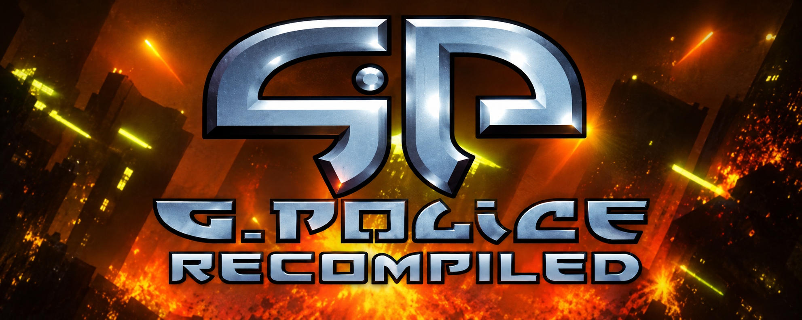

<p align="center"></p>

# G-Police Recompiled

G-Police Recompiled is an active static-recompilation and reverse-engineering
project for the original PlayStation release of **G-Police**. It uses
[PSXRecomp](https://github.com/RetroPortingToolKit/psxrecomp) for translated
game and BIOS code and
[recomp-ui](https://github.com/RetroPortingToolKit/recomp-ui) for the launcher.

This is no longer treated as a frozen release-candidate recipe. The current
work includes framework integration, two-disc runtime support, overlay
coverage, game architecture research, and asset-format documentation intended
to support the companion
[G-Police Blender](https://github.com/Tzeentchnet/G-Police-Blender) add-on.

> [!IMPORTANT]
> The project is in active development. Both discs pass bounded native startup
> checks, but a complete interactive playthrough, disc change, save/load, and
> release-package acceptance have not yet been completed.

## Goals

- Keep the title buildable against a current, explicitly pinned PSXRecomp.
- Support both USA discs without distributing copyrighted game or BIOS data.
- Move resident and runtime-loaded game code toward native coverage.
- Document the executable, resource system, and asset formats as they are
  verified.
- Share format knowledge with the Blender add-on without coupling its parsers
  to the recompilation runtime.

## Project lineage

This work began from
[alexbeavs-ps1-ports/g-police-recomp](https://github.com/alexbeavs-ps1-ports/g-police-recomp),
which supplied the standalone owned-input setup candidate and initial title
configuration. That repository remains the project basis and should receive
credit for the initial port.

The current tree is expected to diverge substantially from that setup
candidate. Upstream attribution does not imply that this tree has the same
behavior, release status, support policy, or generated outputs. Framework
changes that are reusable by other titles are tracked separately in
[docs/UPSTREAM.md](docs/UPSTREAM.md).

## Documentation

| Document | Purpose |
| --- | --- |
| [Architecture](docs/ARCHITECTURE.md) | How the title, code modules, memory layout, discs, and recompilation pipeline fit together |
| [Formats](docs/FORMATS.md) | Verified and inferred game-data structures, including notes for the Blender add-on |
| [Upstream findings](docs/UPSTREAM.md) | PSXRecomp/recomp-ui integration findings that may become upstream issues or pull requests |
| [Feasibility and validation](docs/FEASIBILITY.md) | What currently works, what has been tested, and what remains unproven |
| [Development log](docs/DEVLOG.md) | Chronological project and inherited baseline history |
| [Title mods](mods/README.md) | Status and policy for G-Police-specific runtime mods |

## Companion tooling

[Tzeentchnet/G-Police-Blender](https://github.com/Tzeentchnet/G-Police-Blender)
is the companion Blender 5.2 importer for assets and XA audio from owned
G-Police PlayStation disc images. Format research is shared between the two
projects, while their runtime and tooling implementations remain independent.

Exact framework revisions are recorded in
[framework_pins.txt](framework_pins.txt) and
[project-manifest.toml](project-manifest.toml). Disc identities are recorded in
[disc_identity.json](disc_identity.json).

## Required owned inputs

You must provide:

- The USA **G-Police** Disc 1 and Disc 2 CUE/BIN images identified by
  [disc_identity.json](disc_identity.json).
- A legally dumped 524,288-byte SCPH-5502/5552 Europe BIOS matching SHA-256
  `1faaa18fa820a0225e488d9f086296b8e6c46df739666093987ff7d8fd352c09`.

Place local disc images under `disc/` and keep each CUE beside the BIN it
references. The `disc/`, `generated/`, build, save, and locally generated BIOS
paths are ignored. They must not be committed or redistributed.

## Development setup

Prerequisites are Git, CMake, Ninja, Python 3, and a supported C/C++ toolchain.
Initialize the pinned framework trees first:

```sh
git submodule update --init --recursive
```

Generate the selected SCPH5552 BIOS backend, resident game code, and audited
static code for `FRONT.BIN` and `GAME.BIN` from owned inputs:

```sh
python scripts/gpolice_psxrecomp_cli.py generate \
  --config game.toml \
  --disc "disc/G-Police (USA) (Disc 1).cue" \
  --bios "/path/to/your/SCPH5552.bin"
```

The metadata-only [overlay profile](aot/overlays.json) verifies the disc,
resident loader evidence, exact module hashes, load ranges, and required
entries before PSXRecomp publishes guarded static translation units under the
ignored `generated/` directory. The title adapter only corrects
profile-driven retail BIOS staging; disc preparation and all code emission
remain delegated to the pinned upstream CLI. Python 3.11 or newer is required
for this AOT step.

Configure and build a full runtime:

```sh
cmake -S . -B build -G Ninja \
  -DCMAKE_BUILD_TYPE=Release \
  -DPSXRECOMP_REQUIRE_GAME_C=ON
cmake --build build --target psx-runtime
```

To exercise the first-run setup path instead, configure with
`-DPSXRECOMP_FORCE_SETUP_HOST=ON`. The setup executable asks for owned disc and
BIOS inputs and performs local generation before rebuilding the full runtime.

## Current validated baseline

As of 2026-11-04:

- PSXRecomp is pinned to `060ef0ab34a27ab9c35ad92f52f573e8cea22086`
  (`v0.3.4-alpha-28-g060ef0ab`).
- recomp-ui is pinned to
  `dd47b1887b1858473bb42c38f4307f0eb1b07e60`.
- The current emitters produce 33 resident-code shards and an SCPH5552 backend.
- The owned-input AOT profile produces two audited module shards plus a static
  dispatcher; no retail bytes or generated retail C are tracked.
- A clean Windows full-runtime configure and build passes.
- A bounded live probe reached the `FRONT.BIN` handoff through guarded native
  dispatch. `GAME.BIN` is audited and linked but still needs an interactive
  gameplay-path check.
- Disc 1 (`SLUS-00544`) and Disc 2 (`SLUS-00556`) each pass a bounded headless
  startup check.

These are engineering checks, not a claim of complete gameplay compatibility.
See [docs/FEASIBILITY.md](docs/FEASIBILITY.md) for the full validation matrix.

## Repository layout

| Path | Role |
| --- | --- |
| `game.toml` | Title identity, executable layout, disc set, BIOS profile, and runtime policy |
| `CMakeLists.txt` | Title-to-framework build integration |
| `aot/overlays.json` | Metadata-only original-disc recipes for the two runtime modules |
| `scripts/gpolice_psxrecomp_cli.py` | SCPH5552-aware adapter over the pinned upstream CLI |
| `codegen_setup.c` | First-run setup-host configuration |
| `seeds/` | Resident executable discovery seeds |
| `docs/` | Project, upstream, architecture, and format research |
| `mods/` | Title-specific mod surface; currently no title mod is shipped |
| `psxrecomp/` | Pinned framework submodule |
| `recomp-ui/` | Pinned launcher submodule |

## Research rules

- Mark facts as verified, inferred, or hypothetical.
- Record the input revision and method for reproducible findings.
- Do not commit extracted retail assets, generated retail code, BIOS dumps, or
  captures containing game code.
- Prefer small metadata fixtures or synthetic fixtures for parser tests.
- Keep generic framework fixes separate from title-specific reverse
  engineering.

## Credits and licensing

Project basis:
[alexbeavs-ps1-ports/g-police-recomp](https://github.com/alexbeavs-ps1-ports/g-police-recomp).
Framework:
[RetroPortingToolKit/psxrecomp](https://github.com/RetroPortingToolKit/psxrecomp).
Launcher:
[RetroPortingToolKit/recomp-ui](https://github.com/RetroPortingToolKit/recomp-ui).

Their licenses and dependency notices remain in their corresponding source
trees. Public PC-format prior art is credited in
[docs/FORMATS.md](docs/FORMATS.md). The original game, assets, and trademarks
belong to their respective owners.
